<picture><source media="(prefers-color-scheme: dark)" srcset="assets/hero-dark.svg" /></picture>

<!-- Buttons in order: LinkedIn, Portfolio, Résumé PDF, GitHub, Email -->
<!-- Note: LinkedIn, Résumé PDF, and Email buttons will be displayed once their URLs are provided -->
<a href="https://portfolio-two-ruddy-4syb857mus.vercel.app/"><picture><source media="(prefers-color-scheme: dark)" srcset="assets/btn-site-dark.svg" /></picture></a>
<a href="https://github.com/Sparsh0325"><picture><source media="(prefers-color-scheme: dark)" srcset="assets/btn-github-dark.svg" /></picture></a>
<picture><source media="(prefers-color-scheme: dark)" srcset="assets/btn-views-dark.svg" /></picture>

Java developer building backend systems and web applications with Spring Boot.

 

<picture><source media="(prefers-color-scheme: dark)" srcset="assets/work-head-dark.svg" /></picture>
<a href="https://github.com/Sparsh0325/elvora"><picture><source media="(prefers-color-scheme: dark)" srcset="assets/work-elvora-dark.svg" /></picture></a>
<a href="https://github.com/Sparsh0325/Bon-Voyage"><picture><source media="(prefers-color-scheme: dark)" srcset="assets/work-bon-voyage-dark.svg" /></picture></a>

 

<picture>
  <source media="(prefers-color-scheme: dark)" srcset="assets/stack-dark.svg" />
  
</picture>

  

<a href="https://github.com/Sparsh0325"><picture><source media="(prefers-color-scheme: dark)" srcset="assets/footer-dark.svg" /></picture></a>
